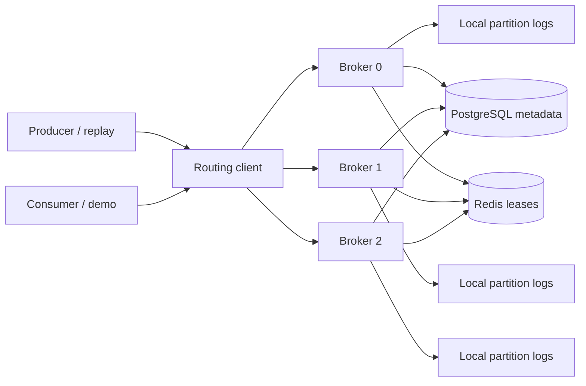

# StreamForge

A Go event-streaming broker built to study durable logs, partition routing, consumer coordination and failure handling. This is an **educational portfolio project, not production-ready infrastructure**.

## Monitoring

Broker request/error counters include overloaded and canceled requests rejected
before handler execution. Structured logs record these failures alongside
handler errors. Prometheus exposes broker counters and request-duration metrics.

This is a custom Go message queue. Measurement details and operational limits
are recorded in [RESULTS.md](RESULTS.md).

## What is implemented

- Persistent partition logs with record offsets, CRC checksums, segment rotation, sparse in-memory indexes,  restart scanning and opt-in automatic segment retention with durable retry pins.
- Three-broker operation with fixed partition ownership; keyed hashing, round-robin routing and explicit partition selection.
- Unary gRPC APIs for topics, publication, batches, reads, committed offsets, groups and failure scheduling.
- PostgreSQL metadata, monotonic next-offset commits, group generations and durable retry jobs.
- Redis membership leases with TTL expiry and generation fencing after membership changes.
- Delayed retries, capped exponential backoff and dead-letter topics carrying original-message provenance.
- Bounded requests, batches and fetches; JSON broker logging; dependency health and Prometheus text metrics.
- Seven executables: broker, admin, producer, consumer, demo, benchmark and replay.

No replication, consensus, automatic failover, authentication, TLS or exactly-once processing guarantee is implemented. The consumer CLI performs one read pass; it is not a continuously polling consumer service.

## Architecture and guarantees



For a fixed broker list, partition `p` belongs to broker `p % brokerCount`. The client discovers owners from topic metadata and connects directly. A request sent to the wrong owner returns a gRPC error with owner information; the server does not proxy it. Changing the configured broker topology is not a supported live rebalance operation.

Ordering exists **within a partition**. Keyed publication uses FNV-1a hashing modulo partition count; unkeyed publication rotates across partitions. A partition mutex serializes appends and assigns contiguous offsets. There is no topic-wide order across partitions. Reads preserve records, allowing independent consumer groups to replay them.

A commit stores the **next offset to read**. After processing offset 7, commit 8. PostgreSQL makes commits monotonic; joining a new group starts independently. Generation and assignment checks fence stale group members. Applications must complete processing before committing and make side effects idempotent: a crash after a side effect but before its commit can cause redelivery.

`FSYNC_MODE=fsync` synchronizes the record file before acknowledgment. `write` acknowledges after a file write into the operating system's cache. Recovery scans records, checks framing/checksums and rebuilds indexes; corrupt or truncated records cause a startup error. Restart recovery uses persisted logs and metadata. Directory synchronization, automatic damaged-tail repair and power-loss durability are not established. Batch publication can leave a successful prefix if a later record fails.

Retry scheduling is durable in PostgreSQL. The worker publishes into `<topic>.retry` or `<topic>.dlq`, then marks the job complete. A crash between those steps can duplicate delivery. Processing a retry and failing it again requires a consumer action; the broker does not execute application handlers.

## Build on Windows

Run from this directory. The existing local setup has Go, PostgreSQL, Redis and generated protobuf code. The tool/cache directories are ignored and will not accompany a future clone. A fresh machine needs compatible Go and database installations; build scripts do not install those dependencies. Optional Windows Docker/WSL setup is supplied separately. The module requires Go 1.25 or later; the audited build used Go 1.27.1.

```powershell
powershell.exe -NoProfile -ExecutionPolicy Bypass -File scripts/build.ps1
```

This builds `bin/streamforge-<name>.exe` for all seven commands. The process-scoped execution-policy option permits these scripts without changing the machine policy. Ordinary builds do not require protoc because generated files are included.

To regenerate the API, install protoc and run `scripts/generate.ps1` with the same invocation style. It uses pinned Go generators. The audit used protoc 29.3, protoc-gen-go 1.36.8 and protoc-gen-go-grpc 1.5.1; fresh output matched both included files exactly.

### Local three-broker demonstration

This path uses the portable databases already installed in this workspace. The PostgreSQL helper uses trust authentication on loopback for local development. Use a separate local Redis instance for each StreamForge cluster: lease keys currently have no cluster namespace.

```powershell
powershell.exe -NoProfile -ExecutionPolicy Bypass -File scripts/local-services.ps1 start
```

In **each of three PowerShell terminals**, enter this setup from the project root. Set `$brokerNumber` to 0, 1 and 2 respectively, then run the broker in the foreground:

```powershell
$brokerNumber = 0
$env:POSTGRES_DSN = 'postgres://streamforge@127.0.0.1:55432/streamforge?sslmode=disable'
$env:REDIS_ADDR = '127.0.0.1:56379'
$env:BROKER_LIST = '127.0.0.1:9001,127.0.0.1:9002,127.0.0.1:9003'
$env:BROKER_ID = "$brokerNumber"
$env:BROKER_ADDRESS = '127.0.0.1:' + (9001 + $brokerNumber)
$env:METRICS_ADDRESS = '127.0.0.1:' + (9101 + $brokerNumber)
$env:DATA_DIR = 'data/brokers/' + $brokerNumber
$env:FSYNC_MODE = 'fsync'
.\bin\streamforge-broker.exe
```

Use a fourth terminal for clients:

```powershell
.\bin\streamforge-demo.exe --broker 127.0.0.1:9001
.\bin\streamforge-admin.exe create-topic --topic orders --partitions 3
.\bin\streamforge-producer.exe --topic orders --key customer-42 --message 'order-created:42'
.\bin\streamforge-consumer.exe --topic orders --group orders-reader --member reader-1 --from committed
Invoke-WebRequest http://127.0.0.1:9101/healthz
Invoke-WebRequest http://127.0.0.1:9101/metrics
```

Use Ctrl+C to stop foreground brokers. Local database shutdown is available through `scripts/local-services.ps1 stop` when those services are no longer needed. The audit's brokers were stopped after execution; do not assume they are still running. Environment changes made in a child PowerShell script do not configure its parent shell, which is why the broker commands explicitly set their environment. The broker does not automatically load `.env`.

### Docker Compose


Copy `.env.example` to `.env` and set a local `POSTGRES_PASSWORD` containing URI-safe characters, such as a generated hexadecimal password. Compose interpolates it directly into the database URL.

```powershell
Copy-Item .env.example .env
# Edit .env to set POSTGRES_PASSWORD before continuing.
docker compose up -d --build --wait
docker compose --profile tools run --rm tools
docker compose --profile tools run --rm --entrypoint admin tools create-topic --broker broker-1:9001 --topic orders --partitions 3
docker compose ps
```


The tools container uses advertised internal addresses `broker-1:9001` through `broker-3:9001`. Host CLIs cannot resolve these Docker service names; run cluster clients in the tools container for this configuration. Prometheus is configured at `http://127.0.0.1:9090`. `docker compose down` stops the stack; named volumes persist. Avoid deleting volumes if you need their data.

## Replay

Replay requires the downloaded archive and an empty topic:

```powershell
.\bin\streamforge-admin.exe create-topic --topic archive.events --partitions 3
.\bin\streamforge-replay.exe --file data/raw/2015-01-01-15.json.gz --topic archive.events --limit 0
```

See [data documentation](data/README.md) for source and provenance. Reusing a nonempty topic fails verification. Parsing streams records; digest/count state uses O(partitions) auxiliary memory. Readback verifies SHA-256 equality of ordered offsets, keys and payloads, joins an exclusive consumer group, heartbeats, commits batches and checks committed resume and zero remaining lag. `--limit 0` reads the entire file; use a fresh exclusive group (the default generates one).

## Design boundaries and future work

Log append is O(record bytes), with occasional rotation/fsync. Startup scans all retained log bytes and rebuilds O(records / index interval) index entries. Seeking binary-searches segments and sparse entries, then scans nearby records. Fetch additionally copies the returned payloads. Group reassignment sorts members and visits partitions. Replay verification uses O(partition count) auxiliary memory plus bounded input/fetch buffers. PostgreSQL and network costs are additional to these in-process bounds.

RETENTION_MAX_SEGMENTS defaults to 0 (disabled). Set a positive count and RETENTION_INTERVAL (default 1m) for automatic inactive-segment trimming. Pending durable retries pin source segments, making the count a soft limit until dispatch completes. Consumer lag does not pin records: expired reads explicitly return OutOfRange. There is no topic deletion workflow. All retained segment handles stay open. Recovery fails closed on corruption; clean shutdown drains RPCs with a timeout, stops workers and closes logs/databases, but an acknowledgment can be ambiguous if cancellation races with an already-started write.


No project license has been selected. Public availability of an archive is not a blanket license for every event's content. Keep raw data, local tools, credentials and audit artifacts out of a public repository.
